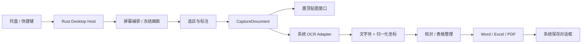

# 萌知 — 系统设计

设计日期：2026-10-29。项目暂名「萌知」，不使用 Snipaste 商标或资源。

## 产品目标

截图、标注、贴图像日常小工具一样直接；识别后可校对文字、整理表格，并导出 Word、PDF、Excel。Windows 10/11 x64 与 macOS 12+（Apple Silicon / Intel）为目标平台。常驻托盘，关闭工作台不退出；首次启动显示使用说明及权限状态。

## 技术决策

- Tauri 2 + Rust：窗口、托盘、全局快捷键、截图、文件保存和本机识别。系统 WebView 渲染界面，不捆绑 Chromium。
- React + TypeScript + Vite：编辑器与交互；不引入大型 UI 框架、动画库或在线字体。
- macOS Vision：Swift 小型 helper，通过标准输入输出/受控临时文件传递 OCR 数据，识别中英文并返回位置。
- Windows.Media.Ocr：使用系统 WinRT OCR，PowerShell helper 返回相同结构。可用语言取决于系统语言包；缺少识别器时明确提示安装。
- docx / xlsx / pdf-lib 按导出类型动态加载。基础版本没有 Python、Paddle、ONNX Runtime 或云端 API 依赖。
- 基础截图使用 macOS 系统 screencapture 与 Windows WinForms 冻结选区；图片只在用户触发时捕获，临时文件在任务完成后清理。首版关闭工作台后隐藏窗口；后续原生快速通道完成后再销毁或延迟创建 WebView，隐藏窗口不代表释放了 WebView 内存。
- 系统 OCR 是基础离线引擎。后续扩展 RapidOCR / PP-Structure 为可下载引擎，必须声明模型来源、版本、校验、体积与许可证，不自动下载。

轻量指标属于验收目标，未实测前不宣传：前端首屏 JS gzip < 180 KB；无识别任务时不加载 OCR 模型；首版核心安装包争取 < 30 MB（不含系统 WebView 与可选模型）。常驻内存和冷启动在两种操作系统上分别记录，不用空窗口数据代替工作台数据。

## 模块与数据流

CaptureDocument：id、name、createdAt、sourceImage、width、height、annotations、ocrBlocks、text、table、engine、revision。OcrBlock：text、confidence（引擎不提供时为 null）、x/y/width/height（左上原点、0..1）。所有原生适配器转换至同一坐标系；macOS Vision 底部原点要反转。

文字与表格允许编辑，导出以用户最后修改的数据为准。保留原图与标注层，修改标注不破坏原像素。历史首版仅在本机保存，提供明确删除动作；不无限堆积大图到 localStorage。

## 截图交互及多显示器

1. 快捷键触发：隐藏本应用会遮挡屏幕的窗口，等待一次合成刷新后捕获。
2. macOS 使用系统交互选区；Windows 首版冻结虚拟桌面供选区。高 DPI、多显示器混合缩放需单独实机验收。
3. 拖动选区，Esc 取消；Windows 最小选区 8×8 像素。首版选区结束后进入工作台标注；选区就近工具条属于后续原生快速通道。
4. 标注与 OCR 使用原始像素尺寸；预览缩放不改变导出分辨率。
5. 贴图使用独立 always-on-top 窗口，支持拖动、透明度、滚轮缩放、Esc 关闭。之后扩展鼠标穿透及贴图分组。

首版不声称已有滚动长截图、窗口自动吸附、跨显示器联合选区或录屏；接口保留，后续独立验收。

## 导出契约

| 格式 | 首版实际含义 | 后续增强 |
|---|---|---|
| Word .docx | 可编辑文字段落、用户校对后的表格，可附原图；不是逐像素版面还原 | 标题/图片/多栏版面恢复 |
| Excel .xlsx | 用户确认后的行列与单元格；普通 OCR 通过位置推断或粘贴 TSV，需校对 | 有线/无线表格模型、合并单元格恢复 |
| PDF .pdf | 原始截图连同标注生成图片 PDF，保持中文和视觉内容；界面标注为「图片 PDF」 | 可搜索文字层、文档重排 PDF |
| PNG | 原像素尺寸合成标注 | JPEG/WebP |

图片 PDF 与可搜索 PDF 不混用名称。CSV 不冒充 xlsx。没有识别结果时允许图片 PDF/PNG；文字与表格导出引导先识别。导出失败保留编辑结果；取消保存不显示成功。

## 原生边界与安全

前端无通用 shell、任意文件写入或任意 URL 执行权限。Rust 只接受受控命令：capture_screen、recognize_image、save_export、copy_image、pin_image。输入限制图片格式、像素数、字节长度与导出扩展名。helper 不使用字符串拼接执行用户内容。OCR 和导出在后台任务中运行，失败可重试，界面不伪造结果。

macOS 屏幕录制权限被拒绝时保留导入图片路径并说明系统设置位置；Windows 识别语言包缺少时保留编辑与图片导出。默认没有遥测、账号、联网识别或自动上传。

## 参考和复用边界

- eSearch：参考截图 → OCR → 校对、贴图与快捷键流程。GPL-3.0。首版不拷贝其代码。
- Snow Shot：参考紧凑工具条、贴图与识别工作流；仓库许可证需按具体版本核验后再决定代码复用。
- Umi-OCR：参考离线、批处理与失败提示。MIT；未来如提取代码保留归属和许可证。
- PaddleOCR / RapidOCR：文档结构识别扩展候选；分别核对代码、模型和依赖许可。
- 本项目自有 UI 和业务逻辑，依赖许可在 THIRD_PARTY.md 记录，不将第三方截图和图标作为自有资产。

## 交付及验证顺序

1. 本文与 DESIGN.md 定义系统、窗口、状态、动效和功能边界。
2. 可运行交互原型：示例明确标注，可导入真实图片、标注、校对、表格编辑、导出。
3. Tauri 桌面接通截图、托盘、快捷键、系统 OCR、贴图、原生保存。
4. macOS 本机编译与使用验证；Windows/macOS CI 分别构建安装包。Windows 成功构建不等于已人工验收。
5. 发布版签名、公证与 Windows 签名需要开发者证书；没有凭据时输出未签名构建，不伪称签名完成。

参考：[Tauri 分发](https://v2.tauri.app/distribute/)、[Windows 安装包](https://v2.tauri.app/distribute/windows-installer/)、[XCap](https://github.com/nashaofu/xcap)、[eSearch](https://github.com/xushengfeng/eSearch)、[Umi-OCR](https://github.com/hiroi-sora/Umi-OCR)、[PaddleOCR](https://github.com/PaddlePaddle/PaddleOCR)、[RapidOCR](https://github.com/RapidAI/RapidOCR)。
